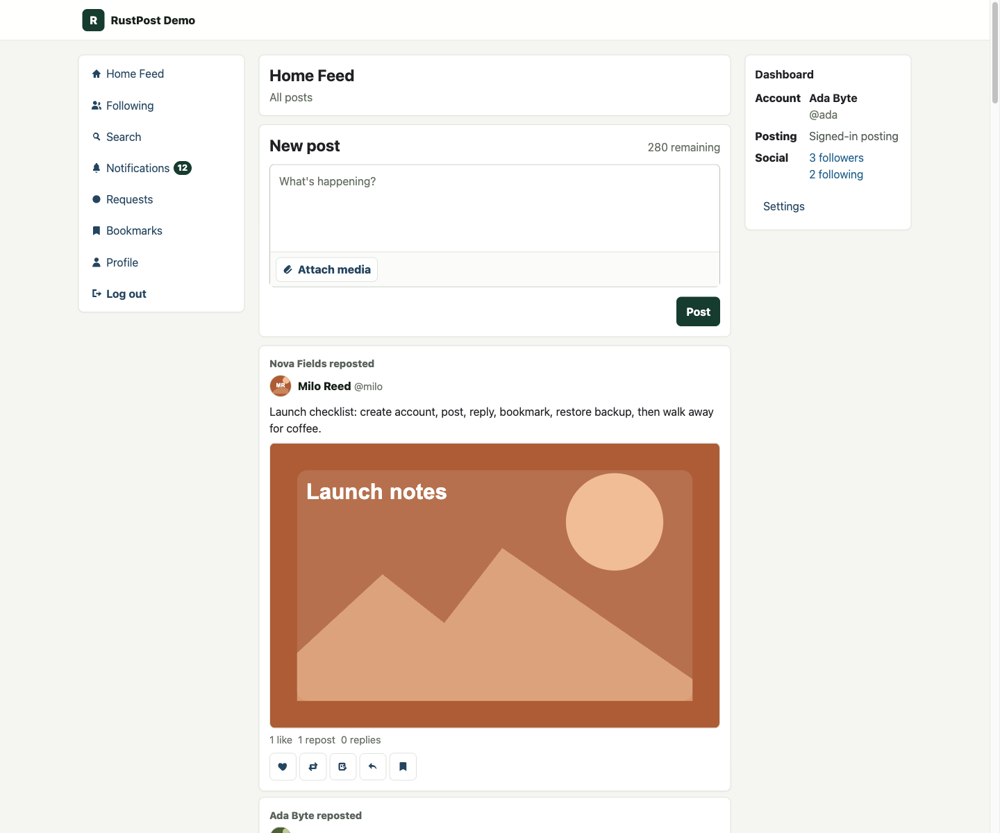
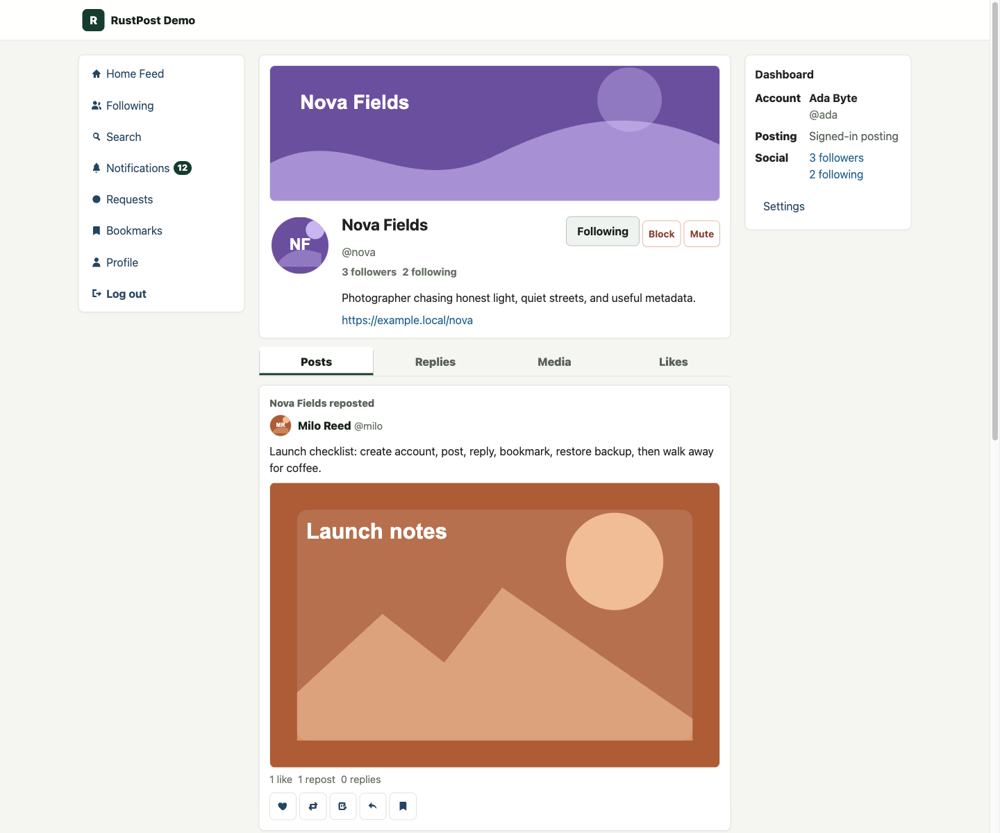
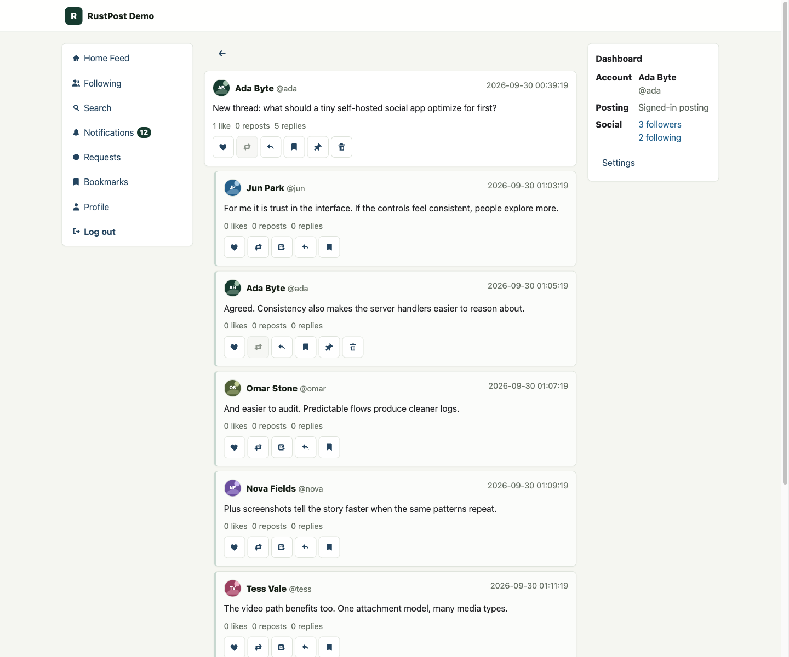
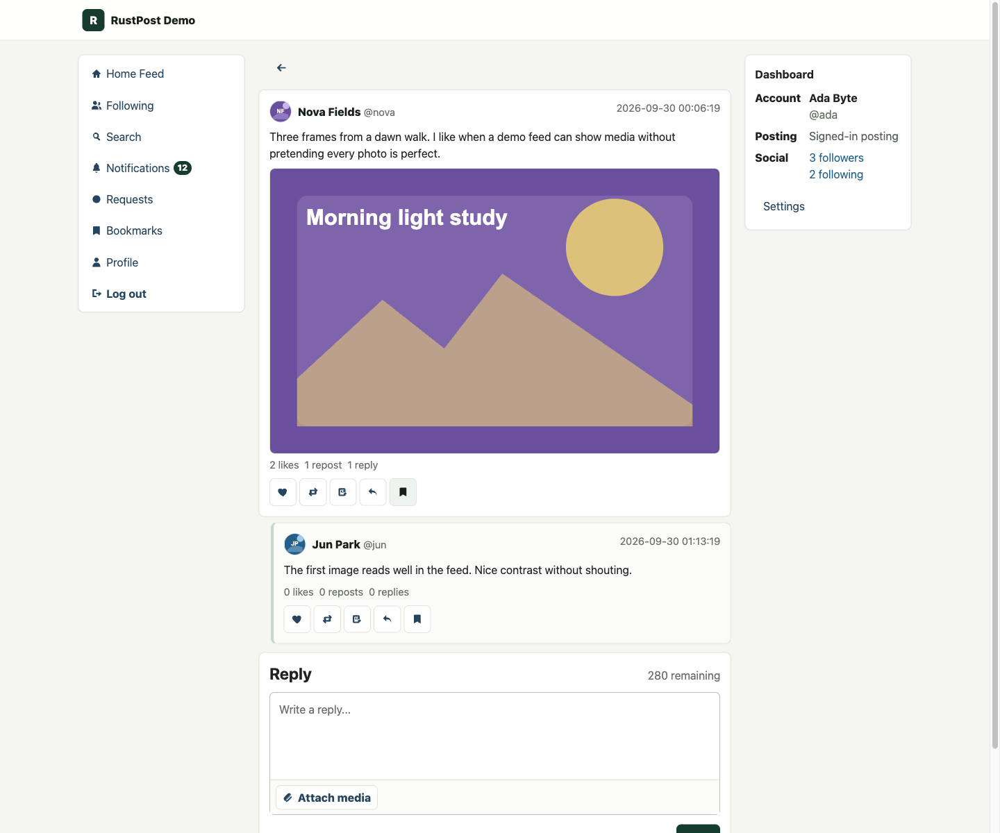
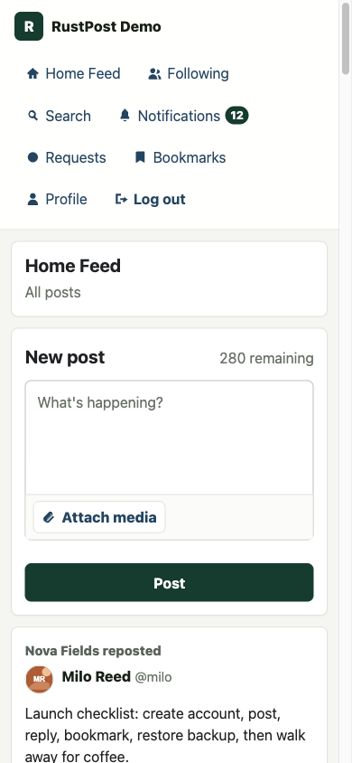

# RustPost

**Your own small social network, on your own computer or server.**

[](https://github.com/csd113/RustPost/actions/workflows/ci.yml)
[](https://github.com/csd113/RustPost/releases/latest)
[](LICENSE)

RustPost is a website for short posts, photos, videos, and conversations. **Self-hosted** means you run the app and look after your community's accounts, settings, and data. People visit your site in a web browser, including on phones.

The app includes its own database. You do not need a separate database server, a cloud account, Docker, or Rust to run a downloaded copy. Each RustPost site is an independent community; it does not share accounts or posts with other social networks.

[Get started](#getting-started) · [Screenshots](#see-the-app) · [Features](#what-you-can-do) · [Manage your site](#manage-your-site) · [All guides](docs/README.md)

## Getting started

### 1. Download the app

Open the [latest published release](https://github.com/csd113/RustPost/releases/latest), expand **Assets**, and download the archive for your computer. Choose the app archive, not GitHub's **Source code** download.

The **v1.1.0** release workflow prepares these downloads. Use them when v1.1.0 is published; if the latest release is still v1.0.0, follow its asset names and checksums instead. [Release packaging](docs/development.md#release-packaging) lists the older names.

| Your computer | v1.1.0 download |
| --- | --- |
| Linux, Intel or AMD 64-bit | `rustpost-cli-v1.1.0-linux-x86_64.zip` |
| Linux, ARM64 | `rustpost-cli-v1.1.0-linux-arm64.zip` |
| macOS, Intel | `rustpost-cli-v1.1.0-macos-intel.zip` |
| macOS, Apple silicon | `rustpost-cli-v1.1.0-macos-apple-silicon.zip` |
| Windows, Intel or AMD 64-bit | `rustpost-cli-v1.1.0-windows-x86_64.zip` |

Download `SHA256SUMS.txt` from the same v1.1.0 release to [verify your download](docs/getting-started.md#verify-a-download). Extract the ZIP, then open a terminal **inside its version/platform folder**, beside `rustpost-cli` (or `rustpost-cli.exe`). The archive includes the executable, README, LICENSE, and CHANGELOG. Media conversion tools such as `ffmpeg` are optional and installed separately for native downloads.

### 2. Run it

On Linux or macOS:

```sh
chmod +x rustpost-cli
./rustpost-cli --data-dir ./rustpost-data serve
```

On Windows, open PowerShell in the extracted folder:

```powershell
.\rustpost-cli.exe --data-dir .\rustpost-data serve
```

Keep the terminal open while using your site. RustPost saves your site in the `rustpost-data` folder. **Keep that folder when updating the app**, and always run from this folder when using these relative-path commands.

### 3. Create your administrator and open the site

Follow the terminal's first-run prompts to choose an administrator username and password. An administrator manages the site. Use a unique password of at least 10 characters; hidden password prompts do not display the characters you type.

Once the server has started, open **[http://127.0.0.1:8080](http://127.0.0.1:8080)** on the same computer and log in. Finish any profile setup shown in the browser, then try writing your first post.

If no administrator prompt appears, open another terminal beside the executable and run `./rustpost-cli --data-dir ./rustpost-data create-admin-interactive` (on Windows, replace `./rustpost-cli` with `.\rustpost-cli.exe`). Use the same data folder as the running app.

This first setup is available on your own computer only. When you are ready to invite people, follow [Make your site public](docs/deployment.md). To stop RustPost, press **Ctrl+C** and wait for it to exit. Run the same command to start it again; your data stays in its folder.

Need more help? Read the [step-by-step setup and troubleshooting guide](docs/getting-started.md). Prefer a container? Use the [Docker quick start](docs/docker.md#start-rustpost). Developers can [build the current dev branch](docs/development.md#build-and-run).

## What you can do

- **Post and talk:** share short posts (280 characters by default), reply, quote, repost, like, and save private bookmarks.
- **Share media:** upload images and videos; add a profile picture, banner, and bio.
- **Find people:** follow accounts, search posts and users, and read notifications.
- **Choose what you see:** block or mute accounts, hide words, and require approval for new followers.
- **Manage your account:** change your username, export or import your data, or request deletion with time to cancel.
- **Run your community:** manage users, publish announcements, pause posting, and create backups.

See [Using RustPost](docs/account-and-instance-features.md) for everyday actions and their limits. Optional [Tor access](docs/operator-guide.md#tor--arti) lets people reach your site through an onion address.

## See the app

### Home feed

Read posts from the community and share an update from the same page.



### Profiles and conversations

Profiles bring a person's bio, follows, and posts together. Replies stay with their original post so conversations are easy to follow.

| Profile | Conversation |
| --- | --- |
|  |  |

### Media and mobile

Images appear within posts, and the layout adapts to smaller screens.

| Image post | Phone layout |
| --- | --- |
|  |  |

These screenshots use fictional accounts and locally generated sample media. You can [run the same demo](docs/demo-preview.md) without using real account data.

## Manage your site

Sign in as an administrator and open **Admin**. Use **Deep server settings** to review settings before saving, **Users** to manage accounts, and **Backups** to save a copy of the site. Most configuration changes need a restart; the settings page explains when each change takes effect.

New registrations are enabled by default; anonymous posting and automatic backups are disabled. You can close registration, rename the site, and adjust post or upload limits. The [operator guide](docs/operator-guide.md) explains these tasks and where your data lives.

**Admin → Software updates** in v1.1.0 checks GitHub and links to a newer stable release. Installation is manual. Follow the [update guide](docs/software-updates.md) to preserve your data.

## Documentation

| I want to… | Guide |
| --- | --- |
| Download, run, and troubleshoot my first site | [Getting started](docs/getting-started.md) |
| Run a container with media tools included | [Docker](docs/docker.md) |
| Learn posting, account settings, and community controls | [Using RustPost](docs/account-and-instance-features.md) |
| Change settings, manage users, or back up and restore | [Operator guide](docs/operator-guide.md) |
| Make the site public with HTTPS | [Deployment](docs/deployment.md) |
| Install a newer version | [Software updates](docs/software-updates.md) |
| Understand the live terminal display | [Terminal console](docs/terminal-console.md) |
| Build, contribute, or prepare a release | [Development](docs/development.md) |
| Explore sample content | [Local demo](docs/demo-preview.md) |
| Browse reference material and history | [Documentation index](docs/README.md) · [Changelog](CHANGELOG.md) |

Reading a README from an extracted app archive? The full guides and screenshots are available in the [online repository](https://github.com/csd113/RustPost/tree/dev).

These guides describe **v1.1.0** and identify older-release differences where needed. A development build can report the same package version as a release while containing different commits; record the source commit with your build. Download availability is determined by the published release page.

RustPost is designed for a single community. Search and reporting tools are basic, media conversion happens during upload, and broader accessibility review remains outstanding. For public deployments, read the [security and dependency notes](docs/deployment.md#security-and-dependency-review).

## License

RustPost is available under the [MIT License](LICENSE). Existing screenshot provenance is described above and in the [demo guide](docs/demo-preview.md).
